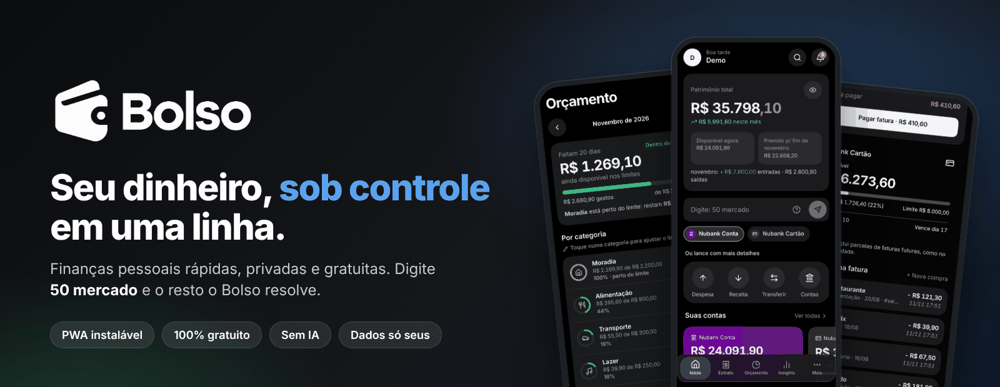
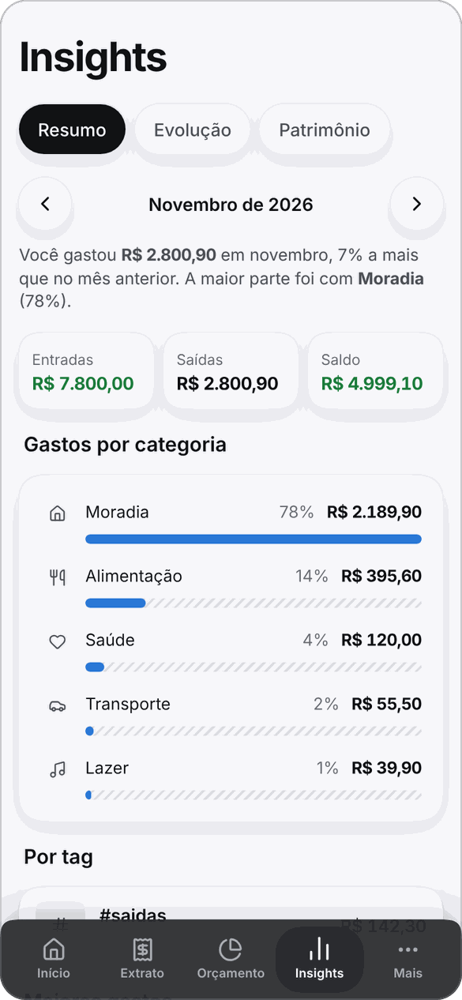
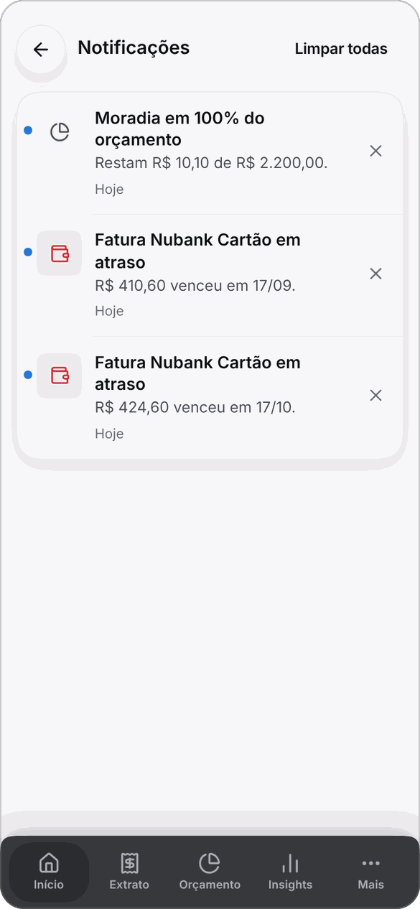
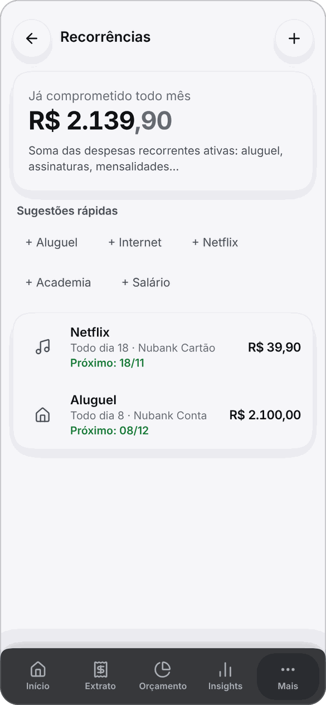
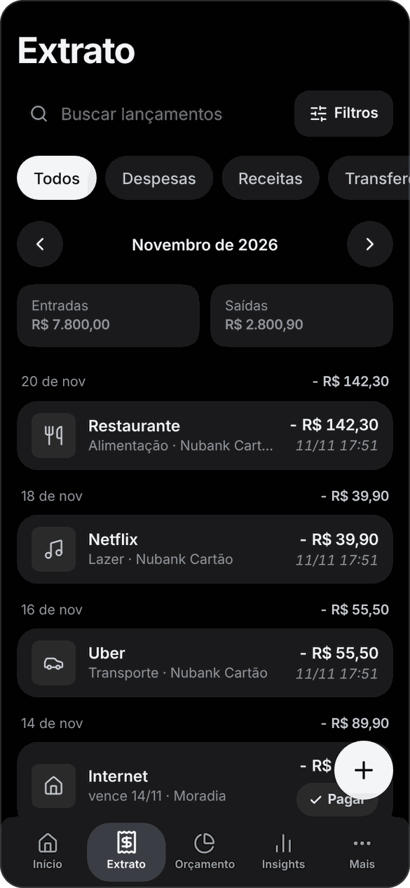
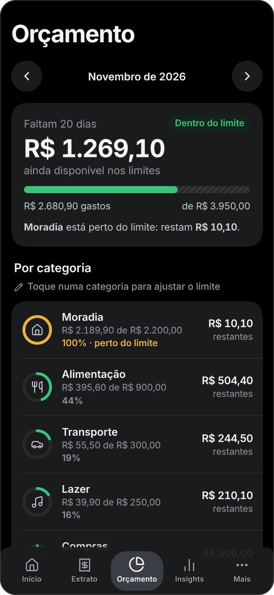
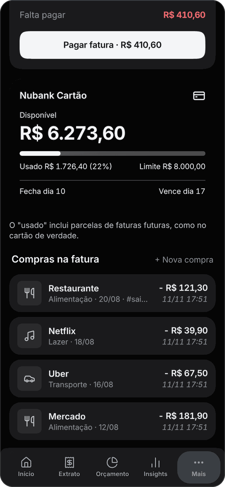
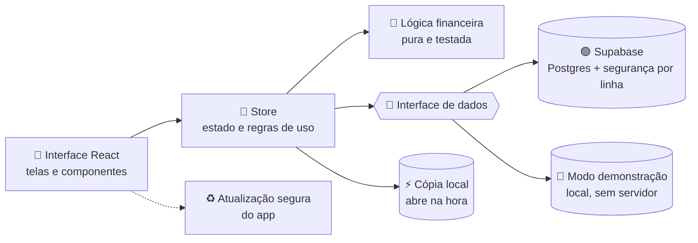

<div align="center">



<br />

⚡ **Registre gastos em segundos, saiba quanto ainda pode gastar.**

<br />


<br />

[▶️ **Experimentar agora**](https://bolso-delta.vercel.app/?demo) &nbsp;·&nbsp;
[✨ Funcionalidades](#-funcionalidades) &nbsp;·&nbsp;
[📱 Telas](#-telas) &nbsp;·&nbsp;
[⚡ Campo rápido](#-campo-rápido) &nbsp;·&nbsp;
[🧱 Arquitetura](#-como-funciona-por-baixo) &nbsp;·&nbsp;
[🚀 Como rodar](#-como-rodar) &nbsp;·&nbsp;
[🇺🇸 English](#-english-summary)

</div>

<br />

> [!NOTE]
> **Bolso** é um app de finanças pessoais que você instala no celular como um aplicativo.
> Lançar um gasto leva **uma linha de texto** (`50 mercado`), a tela inicial mostra **quanto vai sobrar no fim do mês** e cada pessoa enxerga **só os próprios dados**. Roda inteiro em planos gratuitos, sem anúncios e sem IA.

<div align="center">

### 👉 Teste em 10 segundos: **[bolso-delta.vercel.app/?demo](https://bolso-delta.vercel.app/?demo)**
*O modo demonstração roda só no seu navegador, com dados de exemplo e sem enviar nada a servidor.*

</div>

---

## ✨ Funcionalidades

<table>
<tr>
<td width="50%" valign="top">

### 🏠 Início
- Patrimônio total, **disponível agora** e **previsto para o fim do mês**
- **Ainda neste mês:** quanto ainda vai sair e entrar, com a lista de compromissos
- Campo rápido com **ícones de conta/cartão** para escolher onde lançar
- Contas em carrossel e atalhos de despesa, receita e transferência

</td>
<td width="50%" valign="top">

### ⚡ Campo rápido
- Digite `uber 23,90`, `+3000 salário`, `300 tv 3x cartão`
- Entende **valor, categoria, conta, data, parcelas e tags**
- **Aprende palavras novas** sozinho
- **Valor padrão por palavra:** `cantina` já lança R$ 15,50

</td>
</tr>
<tr>
<td width="50%" valign="top">

### 💳 Cartões e faturas
- Fechamento, vencimento e **fatura de cada mês** (inclusive parcelas futuras)
- **Pagar fatura** em um toque, com fatura vencida em destaque
- Limite em um **cartão visual**: disponível, barra de uso, fechamento e vencimento

</td>
<td width="50%" valign="top">

### 🎯 Orçamento
- Limite mensal por categoria, com barras de uso
- Avisos aos **80%** e **100%**
- **Ritmo do mês:** *"você já usou 60% do orçamento com 30% do mês"*

</td>
</tr>
<tr>
<td width="50%" valign="top">

### 🗂️ Categorias inteligentes
- **Palavras-chave** em lista, cada uma com valor padrão opcional
- **Sugestões do histórico** (descrições que se repetem)
- Regras **por conta** (vale-alimentação só aceita alimentação)
- **Reordenar** arrastando, **arquivar** e **mesclar ao apagar**, com "Desfazer"

</td>
<td width="50%" valign="top">

### 📊 Insights
- Resumo do mês por categoria
- **Gasto por tag** (toque para ver o extrato daquela tag)
- Evolução mensal e patrimônio ao longo do tempo

</td>
</tr>
<tr>
<td width="50%" valign="top">

### 🔁 Recorrências
- Aluguel, assinaturas, salário: lançados automaticamente
- Total **comprometido por mês**, receitas fixas e sobra
- Próxima data de cada uma, ordenadas

</td>
<td width="50%" valign="top">

### 🔔 Notificações
- Orçamento estourando, faturas e contas a vencer
- Marcam como vistas ao abrir; ✕ para excluir
- **Limpar todas** com um toque

</td>
</tr>
<tr>
<td width="50%" valign="top">

### 📲 Experiência de app
- Instala na tela inicial e **abre na hora** (cópia local dos dados)
- **Atualiza sozinho**, sem atrapalhar o que você está fazendo
- Barra inferior no celular, menu lateral no computador
- Deslizar a linha para **pagar** ou **apagar**

</td>
<td width="50%" valign="top">

### 🔐 Privado de verdade
- Cada pessoa vê só o que lançou, garantido pelo banco
- Sem anúncios, sem rastreadores, **sem IA**
- **Ocultar valores** com um toque
- Exporta tudo em **CSV** e **JSON**

</td>
</tr>
</table>

---

## 📱 Telas

<div align="center">

| Início | Extrato | Orçamento | Cartão |
|:--:|:--:|:--:|:--:|
|  |  |  |  |

| Insights | Categorias | Notificações | Recorrências |
|:--:|:--:|:--:|:--:|
|  |  |  |  |

**🌙 Modo escuro**

| Início | Extrato | Orçamento | Cartão |
|:--:|:--:|:--:|:--:|
|  |  |  |  |

</div>

Responsivo: barra colada no rodapé no celular e no tablet, menu lateral com duas colunas no computador. Atalhos no computador: `N` novo lançamento · `/` buscar · `Esc` fecha janelas.

---

## ⚡ Campo rápido

No topo do Início, digite e o Bolso registra por regras fixas (sem IA):

| Digite | Resultado |
|---|---|
| `50 mercado` | Despesa de R$ 50 em Alimentação |
| `uber 23,90` | Despesa em Transporte |
| `+3000 salário` | Receita em Salário |
| `300 tv 3x cartão` | R$ 300 em 3 parcelas no cartão |
| `ontem 12 padaria #trabalho` | Com data e tag |
| `cantina` | Usa o **valor padrão** da palavra; se não houver, abre o formulário já preenchido |

Toque nos ícones sob o campo para escolher a conta do próximo lançamento (por exemplo, Swile e `480 vr`). Palavra desconhecida abre o formulário preenchido e, ao salvar, o Bolso **aprende** a palavra.

---

## 🔑 Acesso e cadastro

O acesso é controlado no banco, e há três jeitos de criar conta (detalhes em [docs/SETUP.md](docs/SETUP.md)):

| Modo | Como |
|---|---|
| 🌍 **Cadastro aberto** | `update public.app_settings set open_signup = true;`: qualquer pessoa com o endereço cria conta |
| 🔗 **Link de convite** | `…/?convite=CODIGO`, com códigos que você cria e pode cortar quando quiser |
| ✉️ **Lista de e-mails** | só e-mails liberados em `allowed_emails` criam conta |

---

## 🧱 Como funciona por baixo

<details>
<summary><b>Ver a arquitetura</b></summary>

<br />



- A **interface de dados** é uma só: o app roda contra o Supabase ou contra o modo demonstração sem mudar nada nas telas.
- Cálculos de saldo, fatura, parcelas, orçamento e previsão ficam em funções **puras**, fáceis de testar.
- As **regras de segurança estão no banco** (um usuário nunca lê os dados do outro), não só no app.

</details>

<details>
<summary><b>Estrutura do código</b></summary>

```
src/
  lib/       lógica financeira pura e testada (saldos, faturas, parcelas, orçamento, previsão,
             campo rápido, recorrências, sugestões, regras de categoria, avisos)
  data/      camada de dados: Supabase e modo demo, com a mesma interface
  pages/     telas (Início, Extrato, Orçamento, Insights, Contas, Categorias…)
  ui/        componentes (editores, folhas, gráficos, campo de valor, busca…)
supabase/    schema.sql (tabelas, regras de segurança, gatilhos)
scripts/     testes de interface, acessibilidade, desempenho e geração de ícones
docs/        configuração (SETUP.md) e ideias futuras (IDEIAS.md)
```

</details>

---

## 🛠️ Tecnologias

<div align="center">


</div>

| Camada | Stack |
|:--|:--|
| 🖥️ Interface | React 19 · TypeScript · Vite · React Router |
| 📲 App instalável | PWA com `vite-plugin-pwa` (Workbox) · cópia local em IndexedDB |
| 🗄️ Banco e login | Supabase · PostgreSQL · segurança por linha (RLS) · gatilhos SQL |
| ☁️ Hospedagem | Vercel · GitHub Actions (rotina diária que evita a pausa do plano gratuito) |
| 🧪 Testes | Vitest · PGlite (banco embutido) · Playwright · axe-core (acessibilidade) |

---

## 🚀 Como rodar

```bash
git clone https://github.com/miguelquintanilhapy/bolso.git
cd bolso
npm install
npm run dev          # sem .env.local roda em modo demonstração; use /?demo para dados de exemplo
```

Para conectar a um banco de verdade:

1. Crie um projeto no [Supabase](https://supabase.com) e rode `supabase/schema.sql` no **SQL Editor** (o arquivo é idempotente).
2. Crie `.env.local` com `VITE_SUPABASE_URL` e `VITE_SUPABASE_ANON_KEY` (chave **anon/publishable**).
3. Rode `npm run dev` e crie a conta.

Passo a passo completo, com Vercel e instalação no iPhone, em **[docs/SETUP.md](docs/SETUP.md)**.

<details>
<summary><b>🧪 Comandos de teste e qualidade</b></summary>

```bash
npm run check          # tipos + testes da lógica + teste do schema SQL
npm run test:schema    # schema, gatilhos e regras do banco num Postgres embutido
npm run qa:rls         # um usuário nunca enxerga os dados do outro

# precisam de um Chromium (CHROMIUM_PATH=/caminho/do/chrome) e do app em http://localhost:4173
npm run build && npx vite preview --port 4173
node scripts/e2e.mjs                 # ponta a ponta
node scripts/qa/a11y.mjs             # acessibilidade (axe-core)
npm run qa:layout && npm run qa:desktop
npm run qa:perf                      # desempenho com milhares de lançamentos
npm run qa:update                    # atualização automática do app
```

</details>

---

## 🗺️ Próximos passos

- 🎙️ **Lançamento por voz** (falar "cinquenta no mercado")
- 🔔 **Notificações push** com o app fechado
- 🏦 **Logos de bancos** nas contas e cartões
- 📦 **Versão nas lojas** (o mesmo código, empacotado com Capacitor)

Mais detalhes em [docs/IDEIAS.md](docs/IDEIAS.md).

---

## 🇺🇸 English summary

<details>
<summary><b>What is Bolso?</b></summary>

**Bolso** is a free, private, installable (PWA) personal-finance app built with **React 19, TypeScript, Vite and Supabase (Postgres + RLS)**, hosted on Vercel's free tier.

- **Rule-based quick entry (no AI):** typing a line like `50 mercado` creates categorized transactions, installments and dated entries; it learns keywords and supports per-keyword default amounts.
- **Credit cards done right:** closing/due dates, per-month invoices (including future installments), invoice payment and a visual limit card.
- **Budgets with pace**, end-of-month forecast, tag and category insights, recurring bills and smart categories.
- **Private by design:** each person only sees their own data, enforced at the database level; no ads, no trackers, no AI.
- **Feels like an app:** installs to the home screen, opens instantly, works in light and dark mode, exports your data any time.
- **Try it:** [bolso-delta.vercel.app/?demo](https://bolso-delta.vercel.app/?demo) runs entirely in your browser with sample data, no account needed.

</details>

---

<div align="center">

Feito com 💚 por [@miguelquintanilhapy](https://github.com/miguelquintanilhapy)

</div>
