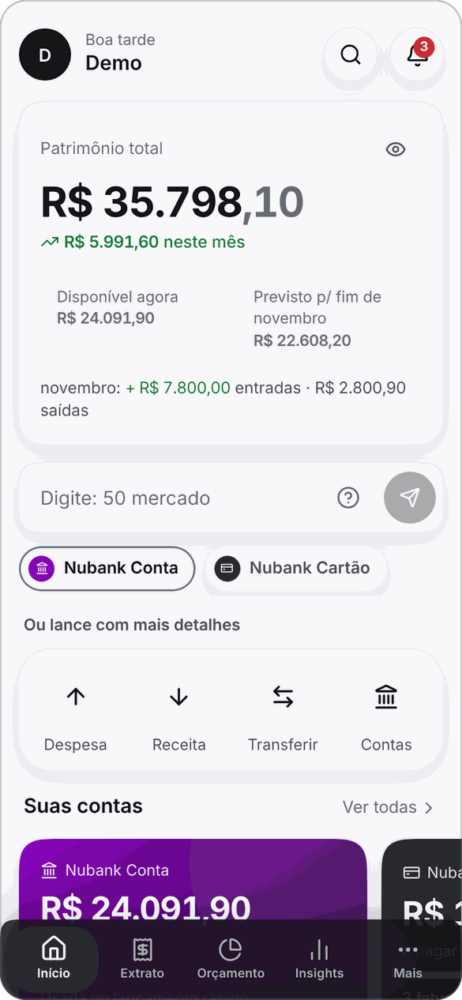
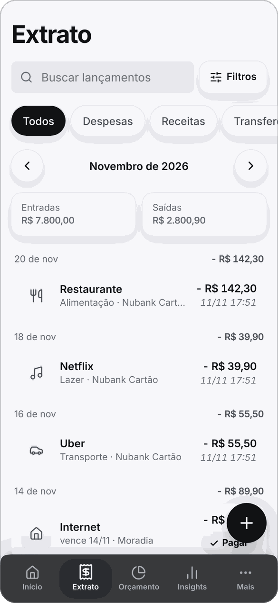
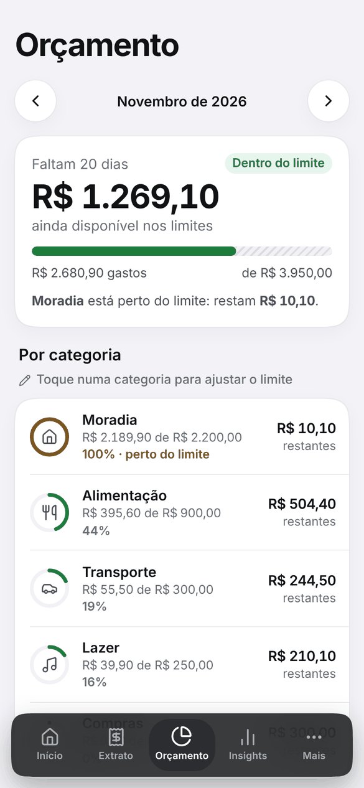
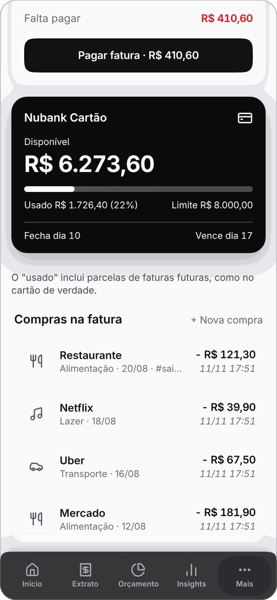
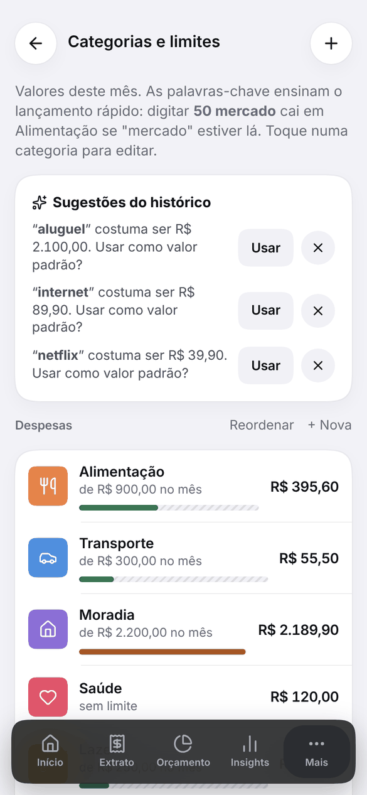
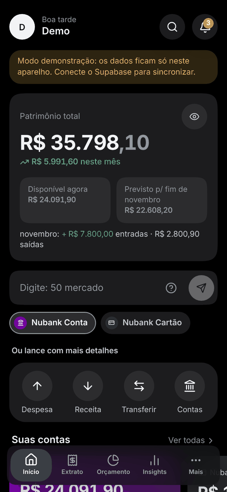

<div align="center">

<picture>
  <source media="(prefers-color-scheme: dark)" srcset="public/logo-white.png">
  
</picture>

**Seu controle financeiro, só seu.**

App de finanças pessoais **gratuito**, **privado** e **instalável no celular** (PWA).
Sem anúncios, sem planilha, sem IA: regras claras e dados separados por pessoa.

<br />






</div>

---

## Sumário

- [O que é](#o-que-é)
- [Recursos](#recursos)
- [Campo rápido](#campo-rápido)
- [Categorias e palavras-chave](#categorias-e-palavras-chave)
- [Cartões e faturas](#cartões-e-faturas)
- [Telas](#telas)
- [Acesso e cadastro](#acesso-e-cadastro)
- [Tecnologia](#tecnologia)
- [Rodar e configurar](#rodar-e-configurar)
- [Qualidade e testes](#qualidade-e-testes)
- [Estrutura do projeto](#estrutura-do-projeto)
- [Privacidade e segurança](#privacidade-e-segurança)
- [Ideias para depois](#ideias-para-depois)

## O que é

O Bolso responde, na hora, às perguntas de quem controla o próprio dinheiro: **quanto eu tenho, quanto ainda vai sair este mês, quanto posso gastar e onde o dinheiro foi**.

- **Barato de manter:** roda 100% nos planos gratuitos do Supabase (banco e login) e da Vercel (hospedagem).
- **Rápido de usar:** lançar um gasto leva uma linha de texto.
- **Instalável:** abre em tela cheia no iPhone e no Android, com ícone próprio, funciona offline para consulta e atualiza sozinho.
- **Cada pessoa vê só os próprios dados:** a separação é garantida pelo banco (RLS), não pelo app.

## Recursos

| | |
|---|---|
| **Contas** | Conta corrente, cartão de crédito e investimentos (saldo atualizado à mão, com histórico). Modelos de banco e benefício (Nubank, Itaú, Swile, VR…) para começar em um toque. |
| **Lançamentos** | Receitas, despesas e transferências, com categoria, tags, observação, horário editável e situação pago/pendente. Parcelamento (`3x`), recorrências geradas sozinhas, busca, filtros e "Desfazer" ao apagar. |
| **Orçamento** | Limite mensal por categoria, barras de uso, avisos a 80% e 100% e **ritmo do mês** ("você já usou 60% com 30% do mês"). |
| **Início** | Patrimônio, disponível agora, **previsto para o fim do mês**, e "Ainda neste mês" (quanto ainda vai sair e entrar, com a lista de compromissos). |
| **Insights** | Resumo por categoria, evolução mensal, patrimônio ao longo do tempo e **gasto por tag** (toque para ver o extrato daquela tag). |
| **Recorrências** | Despesas e receitas fixas: total comprometido por mês, receitas fixas, sobra e próxima data de cada uma. |
| **Notificações** | Avisos de orçamento, faturas e contas a vencer, dentro do app; marcam como vistas ao abrir e podem ser excluídas. |
| **Conforto** | Ocultar valores, tema claro/escuro, atalhos de teclado, exportação CSV e backup JSON. |

## Campo rápido

No topo do Início, digite e o Bolso registra por regras fixas (sem IA):

| Digite | Resultado |
|---|---|
| `50 mercado` | Despesa de R$ 50 em Alimentação |
| `uber 23,90` | Despesa em Transporte |
| `+3000 salário` | Receita em Salário |
| `300 tv 3x cartão` | R$ 300 em 3 parcelas no cartão |
| `ontem 12 padaria #trabalho` | Com data e tag |
| `cantina` | Usa o **valor padrão** da palavra, se ela tiver um; senão abre o formulário preenchido |

Os ícones sob o campo escolhem a conta ou o cartão do próximo lançamento (ex.: toque em Swile e digite `480 vr`).
Palavra desconhecida abre o formulário já preenchido e, ao salvar, o Bolso **aprende** a palavra.

## Categorias e palavras-chave



- **Gasto do mês** por categoria, com barra de uso do limite.
- **Palavras-chave** em lista: cada uma pode ter um **valor padrão**, e digitar só a palavra no campo rápido já lança esse valor.
- **Sugestões do histórico:** o app percebe descrições repetidas e oferece guardá-las como palavra-chave, já com o valor que mais se repete.
- **Categorias por conta:** um cartão pode aceitar só algumas categorias (ex.: vale-alimentação só para alimentação), com regra no banco.
- **Reordenar** arrastando, **arquivar** (some dos formulários, mantém o histórico) e **mesclar ao apagar** (move os lançamentos e as palavras-chave para outra categoria, com "Desfazer").

<br clear="right" />

## Cartões e faturas

- Fechamento, vencimento e **fatura mensal** correta para cada compra, inclusive parcelas em faturas futuras.
- **Pagar fatura** em um toque, com fatura vencida destacada.
- O limite vira um **cartão visual** na cor da conta: disponível em destaque, barra de uso, limite e dias de fechamento e vencimento.

## Telas

| Início | Extrato | Orçamento | Escuro |
|:--:|:--:|:--:|:--:|
|  |  |  |  |

Responsivo: barra inferior no celular, janelas centralizadas no tablet e menu lateral com duas colunas no computador (≥ 1024 px).
Atalhos no computador: `N` novo lançamento · `/` buscar · `Esc` fecha janelas.

## Acesso e cadastro

O acesso é controlado no banco. Há três jeitos de uma pessoa criar conta (detalhes em [docs/SETUP.md](docs/SETUP.md)):

1. **Cadastro aberto:** `update public.app_settings set open_signup = true;` e qualquer pessoa com o endereço cria conta. Para fechar de novo, `false`.
2. **Link de convite:** `…/?convite=CODIGO`, com códigos em `invite_codes` (cortar = `active = false`).
3. **Lista de e-mails:** só e-mails em `allowed_emails` criam conta.

## Tecnologia

- **Interface:** React 19, TypeScript, Vite, `lucide-react`; PWA com `vite-plugin-pwa` (atualização segura, só recarrega quando não há nada a perder).
- **Dados:** Supabase (Postgres, login por e-mail e senha, regras de segurança por linha); cópia local em IndexedDB para abrir na hora; **modo demonstração** local, sem servidor.
- **Hospedagem:** Vercel (com política de segurança de conteúdo e cabeçalhos restritos em `vercel.json`).
- **Testes:** Vitest (lógica), PGlite (schema e regras de acesso do SQL), Playwright (interface) e axe-core (acessibilidade).

## Rodar e configurar

Passo a passo completo do Supabase, do Vercel e da instalação no iPhone em **[docs/SETUP.md](docs/SETUP.md)**.

```bash
npm install
npm run dev        # sem .env.local roda em modo demonstração; use /?demo para dados de exemplo
npm run build
```

Para conectar a um banco de verdade, crie `.env.local` com `VITE_SUPABASE_URL` e `VITE_SUPABASE_ANON_KEY` (chave **anon/publishable**; nunca a `service_role`) e rode `supabase/schema.sql` no SQL Editor. O arquivo é idempotente: pode rodar de novo a cada atualização.

## Qualidade e testes

```bash
npm run check          # tipos + testes da lógica + teste do schema SQL
npm run test:schema    # schema e regras do banco num Postgres embutido
npm run qa:rls         # um usuário nunca enxerga os dados do outro
```

Teste de interface e acessibilidade (precisam de um Chromium; `CHROMIUM_PATH=/caminho/do/chrome`):

```bash
npm run build && npx vite preview --port 4173      # em um terminal
node scripts/e2e.mjs                                # em outro: ~200 verificações de ponta a ponta
node scripts/qa/a11y.mjs                            # axe-core em todas as telas, claro/escuro, celular/computador
npm run qa:layout && npm run qa:desktop             # layout em vários tamanhos
npm run qa:perf                                     # desempenho com milhares de lançamentos
npm run qa:update                                   # atualização automática do app
```

A lógica financeira (saldos, faturas, parcelas, orçamento, previsão) é pura, testada em vários fusos horários (São Paulo, UTC, Auckland, Kolkata, Honolulu).

## Estrutura do projeto

```
src/
  lib/       lógica financeira pura e testada (saldos, faturas, parcelas, orçamento, previsão,
             campo rápido, recorrências, sugestões, regras de categoria, avisos)
  data/      camada de dados: Supabase e modo demo local, com a mesma interface
  pages/     telas (Início, Extrato, Orçamento, Insights, Contas, Categorias…)
  ui/        componentes (editores, folhas, gráficos, campo de valor, busca…)
supabase/    schema.sql (tabelas, RLS, gatilhos) e seed de e-mails
scripts/     testes de interface, acessibilidade, desempenho, geração de ícones
docs/        SETUP.md (configuração) e IDEIAS.md (o que ficou para depois)
.github/     rotina diária que evita a pausa do projeto gratuito do Supabase
```

## Privacidade e segurança

- **Dados separados por pessoa** por regras no banco (RLS), com teste automático (`qa:rls`).
- **Sem chave de administrador no app:** só a chave pública (`anon`); a `service_role` nunca é usada.
- **Sem IA e sem rastreadores:** nada sai do seu banco; o app não chama serviços de terceiros além do Supabase.
- **Seus dados são seus:** exportação em CSV e backup em JSON em **Mais → Seus dados**; o Bolso nunca apaga nada por conta própria.
- Política de segurança de conteúdo restritiva e cabeçalhos de proteção (`vercel.json`).

## Ideias para depois

Lançamento por voz, notificações push com o app fechado e logos de bancos estão anotados em [docs/IDEIAS.md](docs/IDEIAS.md). O caminho para app nativo (Capacitor, mantendo o PWA como está) fica para quando fizer falta.

---

<div align="center">
Feito com cuidado para o dia a dia de quem quer enxergar o próprio dinheiro.
</div>
